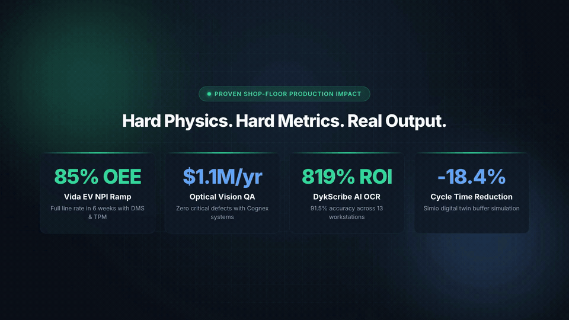

# 🏭 ManuFX — Engineering & AI Portfolio

**Bridging physical manufacturing systems with modern artificial intelligence.**

> **Live Portfolio**: Explore interactive project breakdowns, 3D tilt cards, and LLM-ready knowledge bases at [manufx.vercel.app](https://manufx.vercel.app).

<div align="center">

[](https://manufx.vercel.app)
[](https://github.com/dreamerskymaster/portfolio/actions)
[](LICENSE)
[](https://linkedin.com/in/as31)
[](https://vercel.com/new/clone?repository-url=https%3A%2F%2Fgithub.com%2Fdreamerskymaster%2Fportfolio)

</div>

<!-- DEMO GIF (5-10 s): scroll the home page from the hero to the impact dashboard, open one project card and its demo. Save as docs/demo.gif, then replace this line with  -->
[](https://manufx.vercel.app)

An open-source, high-performance portfolio and industrial AI showcase built for engineers, technical recruiters, and manufacturing leaders. Powered by React 18, Vite, Tailwind CSS, and zero-dependency static SSR prerendering for AI search engines.

---

## ⚡ Quick Start (One Command)

Clone, install dependencies, and launch the development server in a single command:

```bash
git clone https://github.com/dreamerskymaster/portfolio.git && cd portfolio && npm install && npm run dev
```

The app will be live at `http://localhost:5173`.

---

## 💡 Key Highlights

- **Static SSR Prerendering for LLMs**: A zero-dependency script (`scripts/prerender.mjs`) generates static semantic HTML for all 43 routes after every build, complete with canonical tags, JSON-LD, OpenGraph cards, and machine-readable context (`/llms.txt` and `/llms-full.txt`). Solves the SPA blank-page problem for ClaudeBot, GPTBot, and PerplexityBot.
- **60fps Fluid Motion**: Custom Framer Motion cubic-bezier curves, hardware-accelerated 3D tilt cards (`useTiltEffect`), animated counter reveals (`useCountUp`), and an optional desktop trailing cursor.
- **Mobile & Battery First**: Automatic coarse-pointer detection (`(pointer: coarse)`) turns off heavy canvas elements, Three.js shaders, and trailing rings on mobile/tablet devices.
- **Dual OLED & Warm Paper Themes**: Instant theme toggle between high-contrast OLED dark mode and an editorial warm paper light theme with zero Flash of Unstyled Content (FOUC).
- **Embedded Technical Glossary**: Interactive tooltips explaining core industrial engineering & AI concepts (TPM, OEE, Lean A3, RAG systems, Computer Vision, Demand Forecasting).

---

## 🛠️ Tech Stack

| Layer | Technologies |
|---|---|
| **Core Frontend** | [React 18](https://react.dev/), [TypeScript](https://www.typescriptlang.org/), [Tailwind CSS](https://tailwindcss.com/) |
| **Motion & Physics** | [Framer Motion](https://www.framer.com/motion/), Custom 3D Tilt Hook |
| **Icons & Design** | [Lucide React](https://lucide.dev/), Custom Glassmorphic Tokens |
| **Build & Tooling** | [Vite 8](https://vitejs.dev/) (ESM native), [Vitest](https://vitest.dev/), ESLint Flat Config |
| **SEO & Machine Readability** | Custom HTML Prerenderer, `/llms.txt`, Schema.org JSON-LD |
| **Deployment** | [Vercel](https://vercel.com/) with automated GitHub Actions CI/CD pipeline |

---

## 📁 Repository Structure

```
├── src/
│   ├── components/       # UI Atoms, Navigation, Tilt Cards, Glossary Tooltips
│   ├── pages/            # Home, About, Projects, Detail, Writings, Resume
│   ├── data/             # profile.ts (single source of truth), technicalTerms.ts
│   ├── utils/            # useTiltEffect, useCountUp, client-side search
│   └── styles/           # Tailwind variables, OLED & warm themes
├── public/               # Static assets, /llms.txt, /llms-full.txt, resume PDF
├── scripts/              # prerender.mjs (static route generator)
├── .github/
│   ├── workflows/        # pipeline.yml (lint, typecheck, audit, test)
│   └── ISSUE_TEMPLATE/   # Bug report and feature request templates
├── CONTRIBUTING.md       # Contribution guidelines & 24h SLA
└── LICENSE               # MIT License
```

---

## 🔧 Available Commands

```bash
# Development & Build
npm run dev          # Start local dev server (port 5173)
npm run build        # Build bundle & prerender 43 static HTML routes + sitemap.xml
npm run preview      # Preview production build locally
npm run prerender    # Regenerate static route HTML without rebuilding JS bundle

# Code Quality & Tests
npm run lint         # Run ESLint across source files
npx tsc --noEmit     # Full TypeScript type check
npm test             # Run Vitest unit tests
```

---

## 🤝 Contributing

Contributions, feedback, and suggestions are welcome! Please check out [CONTRIBUTING.md](CONTRIBUTING.md) for local development setup and pull request guidelines.

I actively monitor this repository and review issues and pull requests **within 24 hours**.

---

## ⭐ Star History

<a href="https://www.star-history.com/?type=date&repos=dreamerskymaster%2Fportfolio">
 <picture>
   <source media="(prefers-color-scheme: dark)" srcset="https://api.star-history.com/chart?repos=dreamerskymaster%2Fportfolio&type=date&theme=dark&legend=top-left" />
   <source media="(prefers-color-scheme: light)" srcset="https://api.star-history.com/chart?repos=dreamerskymaster%2Fportfolio&type=date&legend=top-left" />
   
 </picture>
</a>

---

## 📄 License

This project is licensed under the [MIT License](LICENSE).
